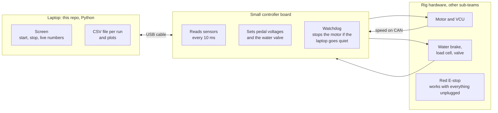

# Start here

This folder explains the project in plain words. You do not need to know Python, electronics, or git before reading it. If something here is unclear, that is a bug in the document: say so on the weekly thread [#35](https://github.com/UBCO-Motorsports/Dyno-Project/issues/35) and someone will fix it.

| File | Read it when |
| --- | --- |
| This page | First. What we are building, the words we use, and how to do your first issue |
| [delivery-plan.md](delivery-plan.md) | You want the dates: sprints, reviews, and the 11 January deadline |
| [open-questions.md](open-questions.md) | You need a real hardware number (arm length, pedal voltage, CAN id). If it is not answered there, do not guess it |
| [overnight-queue.md](overnight-queue.md) | You are labelling work for the overnight coding agent |
| [github-setup.md](github-setup.md) | You are wiring secrets, Lola, or the overnight agent on GitHub Actions |
| [Run Coding agent](https://github.com/UBCO-Motorsports/Dyno-Project/actions/workflows/agent.yml) | **Button:** ask Grok to work on an issue now (Run workflow → issue number), or comment `/grok now` on the issue |
| [canvas/dyno-delivery-plan.canvas.tsx](canvas/dyno-delivery-plan.canvas.tsx) | You use Cursor and want the interactive version of the plan, with diagrams (see the end of this page) |

## The project in five minutes

A **dynamometer** ("dyno") is a test stand that measures how hard a motor can push. We are rebuilding the software for an old water-brake dyno so we can test the EV2 motor in the shop instead of on the track.

How it works physically:

1. The motor turns a shaft. The shaft turns a **water brake**: a drum that fills with water. More water means more drag, so the motor has to work harder.
2. The water brake tries to spin with the motor. A **reaction arm** stops it, and a **load cell** on that arm measures the force. Force times arm length is **torque**: how hard the motor twists.
3. The motor controller reports **speed** in rpm on the car's **CAN bus** (the car's internal network).
4. **Power** = torque × speed. That is the number used to judge a motor change.
5. The motor is normally told what to do by the driver's pedal. On the dyno there is no driver, so we generate fake **pedal voltages** and send them to the **VCU** (the car's main computer), which then asks the motor for torque.

How the software is split:



The laptop is allowed to be slow or to crash. The controller and the E-stop are what keep the rig safe. That split is the most important design decision in the project.

## What we deliver, and when

- **MVP, Thursday 26 November.** MVP means minimum viable product: the smallest thing that is genuinely useful. Ours is one low-load run where torque is calibrated, the valve is set by hand from the screen, the run is saved to a file and plotted, and the motor can be stopped at any moment.
- **Validation, Thursday 3 December.** We check the rig's numbers against things our software did not produce: a known weight, a handheld tachometer, a hand calculation.
- **Handover, Monday 11 January.** A document so next term's team can run the rig without us.

Automatic load control (the valve holding a speed by itself) is **stretch** work: only after the MVP is accepted. Details and dates are in [delivery-plan.md](delivery-plan.md).

## Words you will see

| Word | Meaning |
| --- | --- |
| Torque (N·m) | Twisting force. Force in newtons × arm length in metres |
| Speed (rpm) | Revolutions per minute |
| Power (kW) | torque × rpm × 2π / 60,000. A check: 10 N·m at 1000 rpm ≈ 1.047 kW |
| Load cell | A sensor that turns force into a tiny voltage |
| Calibration | Hanging known weights on the arm and recording what the sensor says, so a raw reading can be turned into newtons |
| Residual | How far one calibration point misses the fitted line. The biggest one is our error figure |
| VCU | Vehicle control unit: the car's main computer. It turns pedal voltages into a torque request |
| CAN | The network that the car's computers use to talk to each other |
| Controller board | A small computer (like an Arduino) that does the fast, timing-critical jobs |
| Heartbeat | A message the laptop sends several times a second meaning "I am still here" |
| Watchdog | A timer on the controller. If heartbeats stop, it puts the rig in the safe state on its own |
| Safe state | Pedal released, water valve set to unload the brake, motor torque zero |
| Simulator | A pretend rig in Python, so the software can be built and tested without the real one |
| Sprint | One week of work, ending with a Thursday review |
| Stakeholder | A person outside the software team whose sign-off we need: Owen and Alex (sensors), Electrical, Mechanical, the safety owners, the project lead |
| Verification | "Does the code do what we wrote?" (the tests) |
| Validation | "Do the numbers match the real world?" (the 3 December checks) |

## How to do your first issue

### 1. Pick one

Open the [issues labelled `board: ready now`](https://github.com/UBCO-Motorsports/Dyno-Project/issues?q=is%3Aopen+label%3A%22board%3A+ready+now%22). Pick one labelled `difficulty: easy` that nobody is assigned to. Assign yourself, then swap its `board: ready now` label for `board: in progress`.

Every issue has the same sections:

| Section | What it tells you |
| --- | --- |
| Schedule (at the top) | The sprint, the due date, and who sees it at the review |
| User story | Who wants this, and why |
| Difficulty | How long it should take |
| Computer science | The idea behind it, in a few sentences. Worth reading even if you only copy the code |
| Who to speak to | Whether you need anyone before you start. Most easy issues: nobody |
| Steps | Exactly what to do, including the test to write |
| Acceptance | The checklist the reviewer uses |

### 2. Set up once

You need [Python 3.11 or newer](https://www.python.org/downloads/) and [git](https://git-scm.com/downloads). In PowerShell:

```powershell
git clone https://github.com/UBCO-Motorsports/Dyno-Project.git
cd Dyno-Project
py -m venv .venv
.\.venv\Scripts\python.exe -m pip install -e ".[dev]"
.\.venv\Scripts\python.exe -m pytest
```

The last line should end with something like `passed`. If it does not, post the output on [#35](https://github.com/UBCO-Motorsports/Dyno-Project/issues/35).

### 3. Test first, then code (TDD)

We use test-driven development. It feels backwards at first, but it is how we know a test can actually catch a mistake:

1. Make a branch: `git switch -c issue-6-reject-bad-inputs` (use your issue's number and name).
2. **Red:** add the test from the issue and run it. It must **fail**, because the code does not exist yet. Copy the failure text.
3. **Green:** write the smallest code that makes it pass. Run all the tests again. Copy the pass.
4. Commit twice if you can: `git commit -m "test: ..."` after step 2, and `git commit -m "feat: ..."` after step 3.

A test written after the code, which has never been seen to fail, does not count.

### 4. Open a pull request

```powershell
git push -u origin issue-6-reject-bad-inputs
```

GitHub prints a link. Open it, and fill in the template: paste the red output and the green output. Swap the issue's label to `board: in review`. A teammate reviews it, runs the tests, and merges it. **You never merge your own pull request**: a second pair of eyes is the point.

### 5. Report on Sunday

One comment on [#35](https://github.com/UBCO-Motorsports/Dyno-Project/issues/35) every Sunday, using the template there. If you are behind, write **at risk**. Saying it on Sunday gives the team four days to help. Saying it at the Thursday review is too late.

## Rules that never bend

- Never spin the motor, connect the tractive battery, or move the valve on the real rig as part of a software issue. The first spin is [#31](https://github.com/UBCO-Motorsports/Dyno-Project/issues/31), and it needs written sign-offs first.
- Never invent a hardware number. If [open-questions.md](open-questions.md) does not have the answer, the value stays an argument to the function and the tests use an obvious example.
- Never push straight to `main`. Everything goes through a pull request.

## Viewing the canvas

[canvas/dyno-delivery-plan.canvas.tsx](canvas/dyno-delivery-plan.canvas.tsx) is the full plan as an interactive page: the timeline, the architecture diagrams, the dependency graph between issues, and the review findings. It only renders inside [Cursor](https://cursor.com). Copy the file into your Cursor canvases folder (`%USERPROFILE%\.cursor\projects\<your workspace>\canvases\`) and open it there. On GitHub it shows as code; the same content is in [delivery-plan.md](delivery-plan.md) as text and diagrams.
