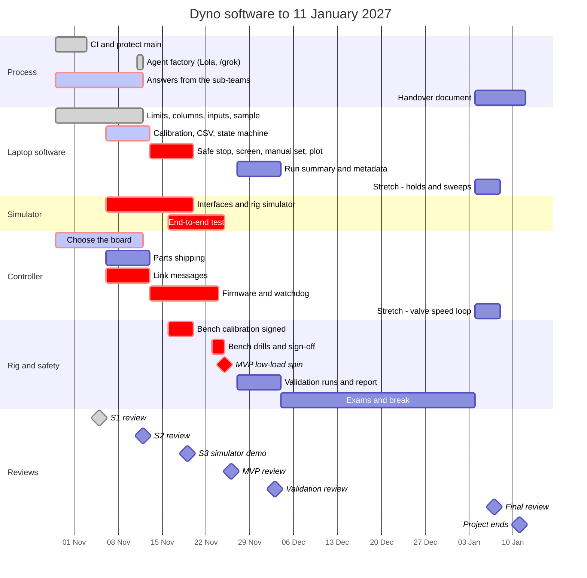
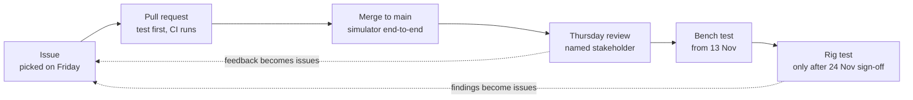

# Delivery plan: 28 October 2026 to 11 January 2027

The project ends on **Monday 11 January 2027**. This page is the schedule: what has to work by when, who checks it, and what happens if something slips. New to the project? Read [docs/README.md](README.md) first; it explains the words used here.

**Last progress update: Wednesday 11 November 2026** (after PRs [#32]–[#34], [#51]–[#58], [#60]).

## Where we are now

| Area | Status |
| --- | --- |
| **S1 coding (due 5 Nov)** | Done on `main`: power [#1], torque [#2], limits [#3], log columns [#4], reject bad inputs [#6], sample record [#10], CI [#36] |
| **S1 people / hardware** | Still open: open questions [#5], controller board choice [#37] — these block firmware [#42] and invent-nothing rules |
| **Process** | Agents and Lola wired ([#57], [#58]); overnight queue and `AGENTS.md` on `main`; ask Grok with label `agent-now` or `/grok now` |
| **S2 (due Thu 12 Nov)** | In progress — next laptop work: calibration [#7]/[#9]/[#8], CSV write [#11], state machine [#17], ports [#21], pedal [#23]/[#39], readout [#26], rig config [#38], link [#40] |
| **MVP date** | Still **Thu 26 Nov** — not slipped; S2 review is the next gate |

Closed coding issues that landed as modules under `src/dyno/`: `power.py`, `torque.py`, `limits.py`, `log_schema.py`, `sample.py` (plus CI/agent workflows, not product maths).

## The short version

| Date | What |
| --- | --- |
| **Thu 26 Nov** | **MVP:** one calibrated, logged, low-load run, with the valve set by hand, that the team can stop at any time |
| **Thu 3 Dec** | **Validation:** the rig's numbers checked against references our software did not produce |
| 4 Dec – 3 Jan | Exams and break. No deadlines |
| Thu 7 Jan | Final review of the handover |
| **Mon 11 Jan** | **Project ends.** Handover merged |

Sprints are one week long and end with a short demo on Thursday. Weekly reports go on the pinned thread [#35] every Sunday.

## Timeline

Red bars are on the path to the MVP. If one of them slips, the MVP date slips. Grey/done bars are already finished on `main`.

## Sprints and stakeholder reviews

Each review is short: show what works, and the named person decides. If they say no, the gap becomes a new issue labelled `stakeholder feedback` within 48 hours, and it goes first in the next sprint. The date does not move.

| # | When | Sprint | What works at the end | Who reviews | Decision |
| --- | --- | --- | --- | --- | --- |
| 1 | Tue 3 Nov | Checkpoint | Answers merged ([#5]) | Owen and Alex, Electrical, Mechanical, safety owners | Real answers, or a promised date for each — **still open; chase in person** |
| 2 | Thu 5 Nov | S1 | CI on; limits, log columns, bad inputs, sample record; boards compared | Project lead; Electrical | **Coding done.** Board pick ([#37]) and answers ([#5]) carried into S2 |
| 3 | Thu 12 Nov | S2 | Calibration fit, CSV writer, state machine, interfaces, pedal pair, rig config, link messages | Owen and Alex; Electrical | Approve the dead-weight procedure, the link messages, and the pedal voltages — **next review** |
| 4 | Thu 19 Nov | S3 | Whole MVP flow on the simulator; controller reads the load cell; bench calibration | Project lead and operators; Owen and Alex | Screen feedback; sign the calibration; rig ready, or switch to the bench fallback |
| 5 | Mon 23 – Tue 24 Nov | Checkpoint | Bench drills: unplug the USB cable, press the E-stop | Mechanical and Electrical safety owners | Written sign-off on [#31] |
| 6 | Thu 26 Nov | S4 | **MVP:** first low-load spin on Wed 25 Nov, logged and plotted | Project lead, Electrical, Owen and Alex | Logged power matches a hand calculation: MVP accepted? |
| 7 | Thu 3 Dec | S5 | Six validation checks and a written report ([#47]) | Owen and Alex; project lead | Sign the report; accept the MVP or list the gaps |
| — | 4 Dec – 3 Jan | Break | Exams and holiday | — | — |
| 8 | Thu 7 Jan | S6 | Handover draft; stretch work, or the fallback spin | Project lead | Approve the handover or list changes |
| 9 | Mon 11 Jan | End | Handover merged; open issues listed for next term | Project lead | Project closed |

The exam period is assumed to be 4 December to 3 January. Check it against the real exam timetable and move only the dates inside the break.

## Issues by sprint

GitHub milestones match these sprints and carry the due dates. Each issue starts with a **Schedule** line saying the same thing.

**S1 · due Thu 5 Nov.** ~~[#36] CI~~, ~~[#3] limits~~, ~~[#4] log columns~~, ~~[#6] bad inputs~~, ~~[#10] sample record~~ (merged). Still open: [#5] questions, [#37] controller board.

**S2 · due Thu 12 Nov (current).** [#7] calibration fit, [#9] apply calibration, [#8] calibration error, [#11] write CSV, [#17] state machine, [#21] interfaces, [#23] pedal clamp, [#26] readout text, [#38] rig config, [#39] pedal pair, [#40] link messages. Plus finish [#5] / [#37] from S1.

**S3 · due Thu 19 Nov.** [#12] read CSV, [#18] safe command, [#27] operator session, [#28] window, [#29] heartbeat, [#30] calibration record, [#41] simulator, [#43] manual controls, [#44] plot.

**S4 · due Thu 26 Nov (MVP).** [#42] firmware and watchdog, [#45] end-to-end test, [#31] the low-load spin.

**S5 · due Thu 3 Dec (validation).** [#13] run summary, [#24] CAN decode, [#25] speed check, [#46] run metadata, [#47] validation report.

**S6 · due Mon 11 Jan.** [#48] handover. [#35] stays open until then.

**Stretch, only after the MVP is accepted.** [#49] valve speed loop, [#15] [#16] [#19] holds and sweeps from a profile, [#22] valve tolerance, [#50] stale channels, [#20] log rate, [#14] malformed log errors. Anything unfinished on 7 January goes into the handover as next term's first work.

**Not in this project.** Lap replay, efficiency maps, and any run above low load.

## How a change gets to the rig

| Test layer | When | What it catches |
| --- | --- | --- |
| Unit tests (pytest) | Every pull request, on CI ([#36] done) | Wrong maths, units, rejected inputs |
| Lola review | Every pull request when `ENABLE_LOLA=true` ([#57]) | Change does not match the issue / tautological tests |
| Shared message tests ([#40]) | Every pull request, in Python and in firmware | Laptop and controller disagreeing |
| Simulator end-to-end ([#45]) | Every pull request | Pieces that do not fit together |
| Thursday demo | Every week | Building the wrong thing |
| Bench test ([#42]) | 13 – 23 Nov | Wiring, timing, calibration, watchdog |
| Rig test ([#31]) | Only after the 24 Nov sign-off | Real behaviour under load |

## Risks

| Risk | Early warning | If it happens |
| --- | --- | --- |
| Thirty MVP issues in four weeks is a lot during midterms | "At risk" lines on [#35] on Sunday | The project lead moves people on Monday. Stretch issues are never started while an MVP issue is at risk |
| The controller arrives late | No delivery date by Mon 9 Nov | Keep building on the simulator. The bench milestones in [#42] move day for day |
| The rig is not mechanically ready on 19 Nov | Answer to question 17 in `docs/open-questions.md` | MVP becomes the same flow on the bench, with the simulator in place of the motor. The spin moves to 4–6 Jan |
| Sub-teams do not answer | Anything still open on Tue 3 Nov | The project lead asks in person on 5 Nov. Code keeps the value as a parameter; nothing is guessed |
| Safety sign-off is refused on 24 Nov | Comments on [#31] after the bench drills | Fix the listed items. No spin until signed. The MVP review becomes a bench demo |

[#3]: https://github.com/UBCO-Motorsports/Dyno-Project/issues/3
[#4]: https://github.com/UBCO-Motorsports/Dyno-Project/issues/4
[#5]: https://github.com/UBCO-Motorsports/Dyno-Project/issues/5
[#6]: https://github.com/UBCO-Motorsports/Dyno-Project/issues/6
[#7]: https://github.com/UBCO-Motorsports/Dyno-Project/issues/7
[#8]: https://github.com/UBCO-Motorsports/Dyno-Project/issues/8
[#9]: https://github.com/UBCO-Motorsports/Dyno-Project/issues/9
[#10]: https://github.com/UBCO-Motorsports/Dyno-Project/issues/10
[#11]: https://github.com/UBCO-Motorsports/Dyno-Project/issues/11
[#12]: https://github.com/UBCO-Motorsports/Dyno-Project/issues/12
[#13]: https://github.com/UBCO-Motorsports/Dyno-Project/issues/13
[#14]: https://github.com/UBCO-Motorsports/Dyno-Project/issues/14
[#15]: https://github.com/UBCO-Motorsports/Dyno-Project/issues/15
[#16]: https://github.com/UBCO-Motorsports/Dyno-Project/issues/16
[#17]: https://github.com/UBCO-Motorsports/Dyno-Project/issues/17
[#18]: https://github.com/UBCO-Motorsports/Dyno-Project/issues/18
[#19]: https://github.com/UBCO-Motorsports/Dyno-Project/issues/19
[#20]: https://github.com/UBCO-Motorsports/Dyno-Project/issues/20
[#21]: https://github.com/UBCO-Motorsports/Dyno-Project/issues/21
[#22]: https://github.com/UBCO-Motorsports/Dyno-Project/issues/22
[#23]: https://github.com/UBCO-Motorsports/Dyno-Project/issues/23
[#24]: https://github.com/UBCO-Motorsports/Dyno-Project/issues/24
[#25]: https://github.com/UBCO-Motorsports/Dyno-Project/issues/25
[#26]: https://github.com/UBCO-Motorsports/Dyno-Project/issues/26
[#27]: https://github.com/UBCO-Motorsports/Dyno-Project/issues/27
[#28]: https://github.com/UBCO-Motorsports/Dyno-Project/issues/28
[#29]: https://github.com/UBCO-Motorsports/Dyno-Project/issues/29
[#30]: https://github.com/UBCO-Motorsports/Dyno-Project/issues/30
[#31]: https://github.com/UBCO-Motorsports/Dyno-Project/issues/31
[#35]: https://github.com/UBCO-Motorsports/Dyno-Project/issues/35
[#36]: https://github.com/UBCO-Motorsports/Dyno-Project/issues/36
[#37]: https://github.com/UBCO-Motorsports/Dyno-Project/issues/37
[#38]: https://github.com/UBCO-Motorsports/Dyno-Project/issues/38
[#39]: https://github.com/UBCO-Motorsports/Dyno-Project/issues/39
[#40]: https://github.com/UBCO-Motorsports/Dyno-Project/issues/40
[#41]: https://github.com/UBCO-Motorsports/Dyno-Project/issues/41
[#42]: https://github.com/UBCO-Motorsports/Dyno-Project/issues/42
[#43]: https://github.com/UBCO-Motorsports/Dyno-Project/issues/43
[#44]: https://github.com/UBCO-Motorsports/Dyno-Project/issues/44
[#45]: https://github.com/UBCO-Motorsports/Dyno-Project/issues/45
[#46]: https://github.com/UBCO-Motorsports/Dyno-Project/issues/46
[#47]: https://github.com/UBCO-Motorsports/Dyno-Project/issues/47
[#48]: https://github.com/UBCO-Motorsports/Dyno-Project/issues/48
[#49]: https://github.com/UBCO-Motorsports/Dyno-Project/issues/49
[#50]: https://github.com/UBCO-Motorsports/Dyno-Project/issues/50
